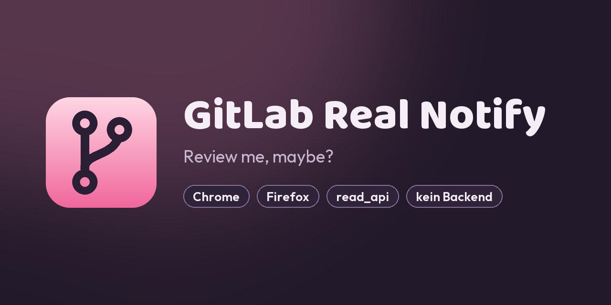
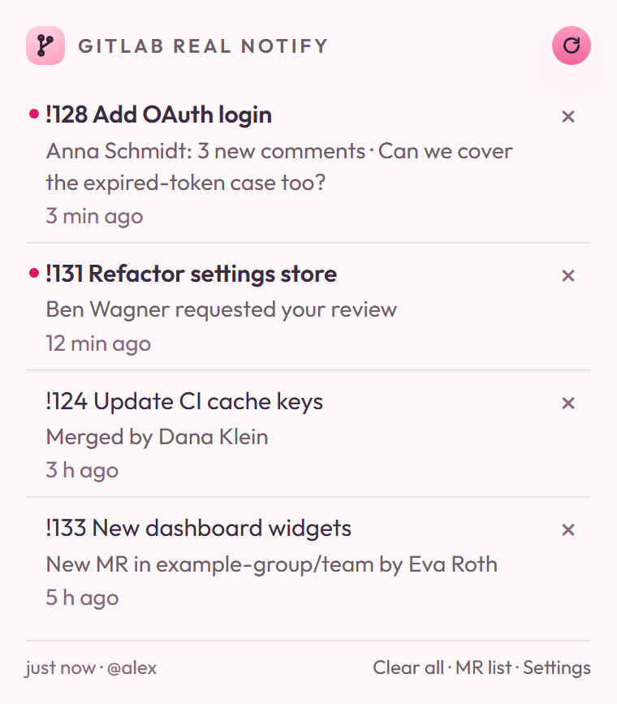
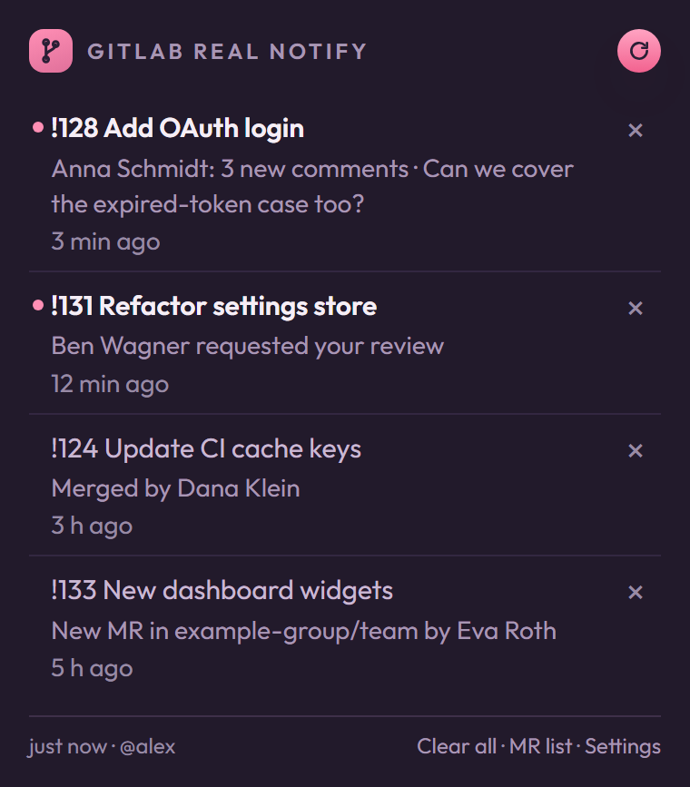
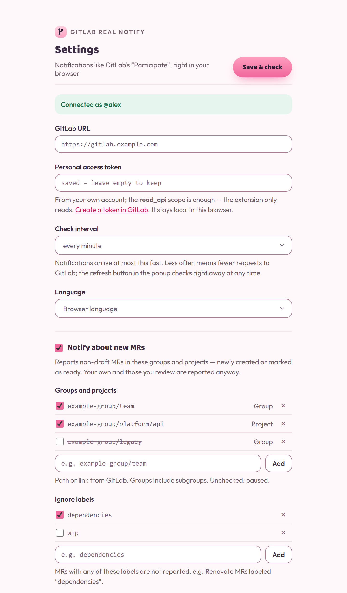

# GitLab Real Notify



Browser extension (Chrome, Firefox) that brings GitLab's **Participate**
notification level to your desktop: desktop notifications for comments on your
MRs and issues, review requests, mentions, approvals, merges, failed pipelines,
drafts that became ready, and more. A popup keeps the recent ones so you can
work through them.

It only reads from GitLab, needs nothing but a personal token with `read_api`,
and keeps everything in your browser. No server in between, no AI, no
tracking: see [Security and privacy](#security-and-privacy).

<p>
  
  
</p>

## What you get notified about

**GitLab to-dos**: everything GitLab puts on your to-do list:

| To-do | Example |
| --- | --- |
| Review requested | Anna requested your review |
| Assigned | Anna assigned you |
| Mentioned / addressed directly | Anna mentioned you: “Hey, can you check …” |
| Approval required | Anna needs your approval |
| Review submitted on your MR | Ben submitted a review |
| Pipeline failed | Pipeline failed |
| Can no longer be merged (conflict) | Can no longer be merged |
| Removed from merge train | Was removed from the merge train |
| Access requested, to-do added by hand | Anna requested access |

**Activity on MRs and issues you're involved in.** Those are MRs and issues
you created, are assigned to or review, threads you commented on (until 30
days without activity) and the targets of your to-dos:

| Event | Example |
| --- | --- |
| New comments | Anna: Looks good, but please add tests · or “Anna, Ben: 4 new comments · Looks good, but …” |
| New commits pushed | Anna added 3 commits |
| Approved / approval revoked | Ben approved this merge request |
| Review requested from someone / assigned to someone | Anna requested review from @ben |
| Draft removed, ready for review | Marked as ready by Anna |
| Merged (with who approved) | Merged by Anna · approved by Ben |
| Closed / reopened | Closed by Anna |

Everything that happens on one MR between two checks becomes **one**
notification, e.g. “Merged by Anna · approved by Ben · Anna added 2 commits”.

**New MRs** (optional, in groups and projects you choose): non-draft MRs that
appear for the first time, “New MR in team/app by Anna”, or, if they were
created as a draft earlier, “Ready for review in team/app by Anna”. Not for MRs
you created, review or are assigned to (those come as to-dos), and not with a
label you ignore.

**Summaries:**

- 6 or more at once (e.g. after sleep): “14 new events in GitLab”.
- After quiet time: “9 new events in GitLab · Collected during your quiet
  time”, only if something is still unread.

**Not notified:** your own actions and those of your alternative bot users;
label, milestone and description changes; mentions a second time as a
comment (they come as a to-do). Connection problems don't pop up: they show
as “!” on the icon and as a message in the popup.

## The popup

- **List of recent notifications** (up to 200), newest first. To-dos stand on
  top, followed by a stronger divider. Unread ones are bold with a dot until
  you open the popup again. The badge on the icon counts the unread ones.
- **Times** show when it happened in GitLab, not when it was checked, so a
  comment from 3 a.m. doesn't say “just now” in the morning. The tooltip has
  the exact time.
- **Labels** of the MR or issue appear as small chips on one line; what doesn't
  fit is counted as “+N”. Your **important labels** are highlighted and always
  come first.
- **Click** a notification to open it in GitLab (it leaves the list), **×**
  removes it without opening.
- **Open all** opens every notification in a background tab, one per MR or
  issue, and takes them off the list.
- **Clear done** asks GitLab and removes what needs nothing from you anymore:
  merged or closed MRs and issues, resolved threads, comments you (or your bot)
  replied to, and new MRs that already have a reviewer.
- **Clear all** empties the list.
- **Bell** mutes pop-ups for an hour (crossed out while quiet); **↻** checks
  right away. The footer links to your MR list in GitLab and to the settings.

## Settings



- **GitLab URL** and **token**: a personal access token of your own account
  with scope `read_api`. The settings link straight to creating one.
- **Check interval:** every 1–30 minutes, default 1.
- **Language:** English or German, default follows the browser.
- **Quiet time:** a time window (may span midnight) and/or the whole weekend
  without pop-ups, by your computer's clock. Everything still lands in the
  list and the badge; afterwards you get one summary.
- **Important labels:** highlighted in the popup and always shown first. `*` is
  a wildcard, e.g. `workflow::*` or `*SLA*`.
- **Alternative bot users:** accounts that act for you, e.g. a bot commenting
  in your name. Nothing they do is notified, and their replies count as yours
  for “Clear done”.
- **New MRs:** groups (including subgroups) or projects to watch, plus labels
  to ignore, e.g. `dependencies` for Renovate MRs.

Each list entry can be paused with its checkbox.

## Security and privacy

**Where is my token?** In your browser's extension storage
(`chrome.storage.local`) on this computer, in your browser profile. Other
websites and other extensions can't read it. It is not encrypted there, the
same as a password in a config file: anyone with access to your browser
profile could read it. Removing the extension deletes it.

**Where does it go?** Only to the GitLab URL you entered, over HTTPS, in the
`PRIVATE-TOKEN` header. Never in a URL, never in an error message, never to
the popup or settings page (they only learn *whether* a token is set). If you
change the GitLab URL, you must enter the token again, so a typo in the URL
can't send your token to a stranger.

**What can it do with it?** As little as possible:

- Scope `read_api` is enough. The extension never writes to GitLab: there is
  exactly one place that talks to GitLab, and it only sends GET requests.
- Browser permissions: storage, alarms (for the check interval),
  notifications, and access to your one GitLab host, which you grant
  explicitly on first save. It gives up access to an old host when you switch.
  No access to your tabs, history or other websites.

**Is AI involved?** No. The extension contains no AI, sends nothing to an AI
service, and talks to no server except your GitLab. No analytics, no
telemetry, no tracking, fonts and icons are bundled.

**What is stored?** Settings, the last 200 notifications (titles, short
comment excerpts, links, labels) and the check state, all locally in the
browser. Nothing leaves your computer except the requests to your GitLab.

**Keep in mind:**

- Notifications show MR titles and comment excerpts in your operating
  system's notification center, and depending on your OS settings on the lock
  screen. On Windows: Settings → System → Notifications → your browser.
- Give the token an expiry date in GitLab and revoke it when you stop using
  the extension.

## Installation

> **Not published yet.** There is no official build in the Chrome Web Store or
> on addons.mozilla.org — for now you install it from source in developer mode.

**Chrome:** `chrome://extensions` → Developer mode → *Load unpacked* → repo
folder.

**Firefox ≥ 128:**

```bash
python firefox.py
```

Then `about:debugging#/runtime/this-firefox` → *Load Temporary Add-on* →
`dist/firefox/manifest.json`. Lasts until restart. For a permanent install,
sign it once: `npx web-ext sign --channel=unlisted --source-dir dist/firefox`.

The settings open after installation. Enter URL and token and click **Save &
check**: the browser asks once for access to your GitLab. The first check only
records the current state, so you won't get a flood of old notifications;
from then on, new things arrive.

---

## How it works

GitLab has no API for “Participate” notifications, so the extension polls the
REST API and works it out itself:

1. **To-dos** (`/todos`): new ones become notifications.
2. **Threads you commented on** (`/events?action=commented`): those MRs and
   issues are watched for 30 days after the last activity.
3. **What changed** (`updated_after` on your MRs, issues and watched ones):
   for each changed item it fetches the new notes and compares state and draft
   flag with what it saw last time.
4. **New MRs** in the chosen groups/projects, if switched on.

Details:

- **Read only.** Every request goes through `get()`, which only knows GET. A
  test checks that there is no other `fetch` and no write verb in the code.
- **Nothing lost, nothing twice.** Checks run one after another; state and
  history are saved in one write at the end. If a check fails, the next one
  repeats it from the last success. After sleep or a closed browser it catches
  up from there. Short network hiccups after unlocking stay silent.
- **Load:** about 10–20 mostly empty requests per check, plus one per changed
  MR/issue and one per project with watched items. Open to-dos keep their MR or
  issue watched, so many open to-dos across many projects mean noticeably more
  (e.g. ~80 per check with 300 to-dos in 40 projects). Rate limits (`429`) are
  respected.
- **Storage:** history is capped at 200 notifications, labels at 8 per
  notification; comment texts are cut before processing, so a huge comment
  can't stall a check.
- **Token:** see [Security and privacy](#security-and-privacy).

**Limitations:**

- Threads you unsubscribed from in GitLab are still reported.
- Threads you only commented on drop out after 30 days of inactivity.
- System notes (commits, approvals, review requests) are matched on their
  English text.
- Quiet time and relative times (“5 min ago”) use your computer's clock; the
  times themselves come from GitLab.

## Development

| File | |
| --- | --- |
| `background.js` | Service worker: polling, state, notifications |
| `popup.*`, `options.*`, `theme.css` | UI, no framework |
| `i18n.js` | All UI and notification texts (en, de), plus the label wildcard match; shared by service worker, popup and settings |
| `tests/` | Browser tests against the real `background.js`, with Chrome and GitLab doubles |
| `firefox.py` | Builds `dist/firefox/` (`background.scripts`, Gecko ID) |
| `icons/make.py` | Generates the icons and `.github/social-preview.png` (Pillow) |

Run the tests:

```bash
python -m http.server 8000
```

Then open `http://127.0.0.1:8000/tests/`. The page title shows `PASS` or
`FAIL n`.

**Release:** bump the version in `manifest.json`, update `CHANGELOG.md`, run
`python firefox.py`, tag `vX.Y.Z`.
