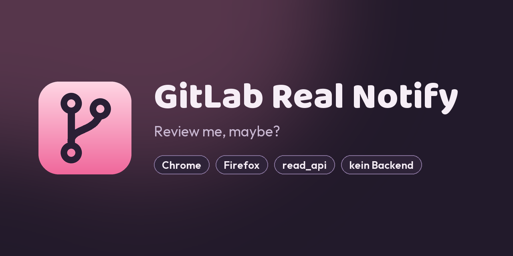

# GitLab Real Notify



Browser extension (Chrome, Firefox) that brings GitLab's **Participate**
notification level to your desktop: comments on your MRs/issues and in threads
you commented on, plus assignments, review requests, todos, merged/closed.
Optionally also new MRs (non-draft) in selected groups/projects, with a label
filter.

Polls the GitLab REST API, needs only a personal token with `read_api` and
never writes anything. No backend, no build step for Chrome.

## Installation

> **Not published yet.** There is no official build in the Chrome Web Store or
> on addons.mozilla.org — for now you install it from source in developer mode.

**Chrome:** `chrome://extensions` → Developer mode → *Load unpacked* → repo
folder.

**Firefox ≥ 128:**

```bash
python firefox.py
```

Then `about:debugging#/runtime/this-firefox` → *Load Temporary Add-on* →
`dist/firefox/manifest.json`. Lasts until restart. For a permanent install,
sign it once: `npx web-ext sign --channel=unlisted --source-dir dist/firefox`.

## Setup

The settings page opens after installation:

- **GitLab URL:** e.g. `https://gitlab.example.com`.
- **Token:** personal access token of your own account, scope `read_api`.
- **Interval:** 1–30 minutes, default 1.
- **Language:** English or German, default follows the browser language.
- **New MRs** (optional): group or project paths, labels to ignore (e.g.
  `dependencies`).

**Save & check** requests the host permission once. The
first run only records the current state and doesn't notify.

## Behavior

- Multiple new comments on the same MR are grouped into one notification; 6 or
  more events at once become a single summary.
- Your own actions are never reported. Mentions arrive as a todo, not twice.
- After sleep or a closed browser it catches up from the last successful poll.
  Short network hiccups stay silent.
- About 10–20 mostly empty requests per run (`updated_after`).

**Limitations:**

- Threads you unsubscribed from in GitLab are still reported.
- Threads you only commented on drop out after 30 days of inactivity.
- System notes are matched on their English text.

## Development

| File | |
| --- | --- |
| `background.js` | Service worker: polling, state, notifications. Every request goes through `get()`, which only knows GET. |
| `popup.*`, `options.*`, `theme.css` | UI, no framework |
| `i18n.js` | All UI and notification texts (en, de), shared by service worker, popup and settings |
| `tests/` | Browser tests against the real `background.js`, with Chrome and GitLab doubles |
| `firefox.py` | Builds `dist/firefox/` (`background.scripts`, Gecko ID) |
| `icons/make.py` | Generates the icons and `.github/social-preview.png` (Pillow) |

Run the tests:

```bash
python -m http.server 8000
```

Then open `http://127.0.0.1:8000/tests/`. The page title shows `PASS` or
`FAIL n`.

**Release:** bump the version in `manifest.json`, update `CHANGELOG.md`, tag
`vX.Y.Z`.
